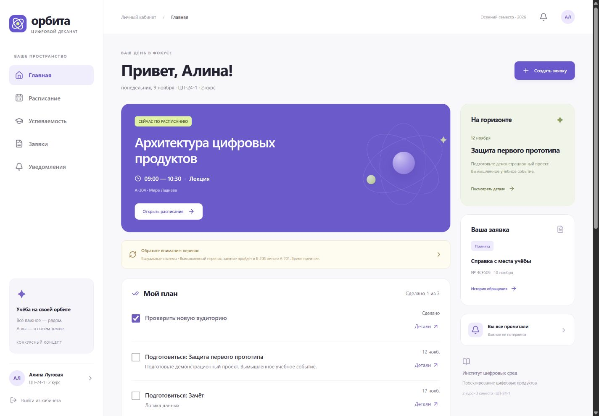
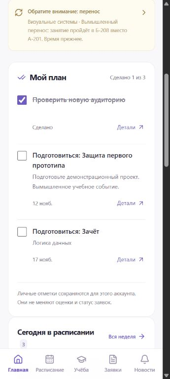
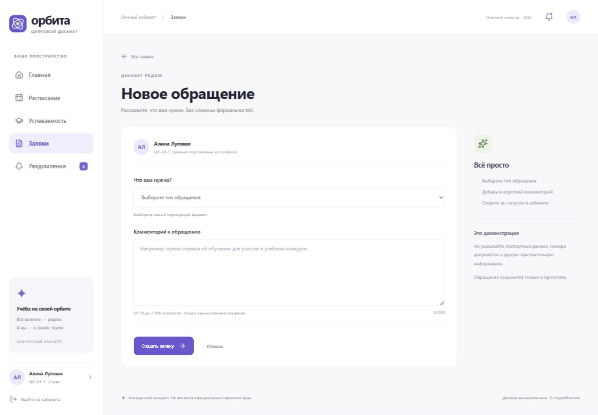
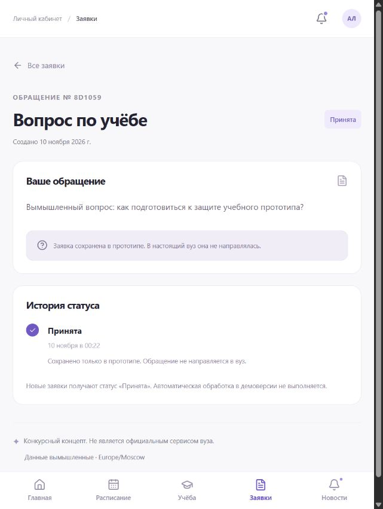

---
tags:
  - Codex/generated
  - проект/цифровой-деканат
created: 2026-11-10
source: Codex
---
# Как создавалась Орбита

[[Запуск и устройство Орбиты]] · [[Работа с ИИ над Орбитой]] · [[Проверка конкурсных требований]]

## 1. Проблема

Студенту нужно собрать учебный день, изменения аудитории, результаты и статус обращения в одном месте. Это постановка из задания, а не доказанный результат пользовательского исследования.

## 2. Почему эти разделы

Главная объединяет ближайшее действие и контекст. Расписание помогает планировать день и неделю. Успеваемость различает готовые и ожидаемые результаты. Заявки дают понятное подтверждение и историю. Уведомления связывают изменение с объектом. Профиль и выход показывают текущую учётную запись и завершают сессию.

## 3. Дополнительные идеи

Название «Орбита» и собственная абстрактная графика поддерживают гипотезу «учебный день под контролем». Заметный блок изменения аудитории стоит выше подробного расписания. Все счётчики вычисляются из данных. Демонстрационные часы и неделю показываем явно. Кабинет сотрудника не добавлен: сценарий честно завершается сохранением, без фиктивной обработки.

## 4. Фактически использованные инструменты

Полный перечень на 2026-11-18.

**ИИ-ассистенты, писавшие код.**

- **Codex desktop** — основной ассистент 9–14 ноября: вертикальный сценарий,
  вход и хранение, разделы кабинета, первые редакции документов. Работал с
  двумя подагентами: `interface` (реализация интерфейса в своих границах
  владения) и `requirements_review` (независимое read-only ревью, без права
  менять файлы).
- **Claude Code, модель Opus** — 15–18 ноября: подключение к открытым данным
  РЭУ, адаптеры единого входа и ведомости, открытая страница расписания,
  раздел «Вайб Плехановки», переработка успеваемости и ленты дня, разбор
  интерфейса по всем экранам, приведение документов к состоянию продукта.

**ИИ для контента и графики.**

- **Встроенный ImageGen** — четыре предметные иллюстрации (архитектурная
  миниатюра, планировщик, папка, книги). Полные отправленные промпты и судьба
  каждого файла — в `scripts/artwork-manifest.json`.
- Изображения людей нейросетями не создавались: вместо портретов — типографские
  монограммы, а в подборке кампуса — собственная съёмка владельца проекта.

**Инструменты без ИИ.** PowerShell, Node.js 24, npm, TypeScript, node:test,
SQLite, Wrangler/Miniflare, Sites, Python с Pillow (подготовка подборки
кампуса), reportlab (сборка этого PDF), браузер для проверки экранов и замеров.
Веб-поиск — проверка официальных ограничений площадки и страниц РЭУ.

**Не использовалось:** Figma и другие редакторы макетов, платные ИИ API,
интервью со студентами. Ручной вклад автора описан в разделе 7.

## 5. Реальные промпты и этапы

Исходное задание пользователя начиналось: «Ты — продуктовая команда в одном лице: продуктовый дизайнер, UX-исследователь, архитектор и full-stack разработчик. Создай работающий прототип личного кабинета студента». Полный текст был предоставлен вложением «Вставленный текст.txt».

Read-only помощнику реально поставлена задача: «Проведи независимое read-only ревью требований … Дай компактный список важнейших рисков приёмки и конкретных проверок изоляции, хранения и UX. Не меняй файлы».

UI-помощнику реально переданы границы владения app/components, страницами, CSS и favicon, идея «учебный день под контролем», визуальное направление, API контракт и требование сначала вертикального сценария. После прохождения API теста отправлено: «Вертикальный API сценарий проверен node:test … Можно расширять UI всеми разделами».

Второе задание ревьюеру: «Выполни read-only ревью, укажи только реальные дефекты с приоритетом». Это выдержки из текущей сессии, не выдуманные прежние диалоги.

**Промпты второго этапа, 15–18 ноября (Claude Code).** Заказчик ставил задачи
короткими репликами, ассистент сам находил причину и предлагал решение.

- *«ты вот прям на 1000% уверен что сейчас нельзя никак сделать так, чтобы
  данные сразу с РЭУ подтягивались при входе каком нибудь?»* — после этого
  разобраны реальные способы подключения: открытый экспорт расписания подошёл,
  вход через внешнего провайдера подтверждает только личность. Результат —
  живое расписание и адаптеры подключения.
- *«нет, в этом нет смысла, мудл и сайт РЭУ имеют разные данные»* — отказ от
  ветки с Moodle. Пример работы с неверной гипотезой ассистента: направление
  было предложено им и отклонено заказчиком.
- *«вот это убирай сверху вообще, такого не должно быть, основная суть
  страницы всегда должна быть сверху, без вариантов»* — служебные подписи
  убраны из шапок разделов в сноску под содержимым.
- *«проработай раздел учёба, очень длинная страница получилась»* — два списка
  одних и тех же дисциплин сведены в одну таблицу с разворотом строки.
- *«вот это окно доработай а то всё криво»* со снимком строки итога — итог
  семестра переделан в три подписанных числа.
- *«проработай эту плашку так, чтобы ничего друг на друга не накладывалось»*
  со снимком ленты дня — слои ленты разведены по трём полосам; замеры границ
  всех слоёв приложены как доказательство.
- *«сделай полный ресерч проекта, протыкай все кнопки, проверь весь визуал»* —
  проход по всем экранам, который нашёл невозможность войти в демо-кабинет,
  пропажу отметки «сейчас» вечером и ошибку выравнивания на телефоне.
- *«проверь каждое правило дословно и скажи чего не хватает до сдачи»* —
  сверка с правилами конкурса, нашедшая официальный логотип вуза на экране
  входа и настоящие ФИО преподавателей в данных расписания.

## 6. Ошибки, ревью и исправления

Установка npm сначала не прошла из ограниченной сети; повтор с сетевым разрешением завершился успешно. Wrangler db setup потребовал разрешения локального запуска/сети. В ревью найдены две реальные проблемы: seed прекращал заполнение при наличии двух студентов, оставляя новые fixtures неприменёнными; тестовый SQLite-адаптер конфликтовал при параллельных транзакциях. Исправлено: идемпотентный seed при первой инициализации isolate и очередь транзакций адаптера. Проверены конкурентные запросы и сохранение.

Ранняя сборка интерфейса временно не запускалась, пока ещё не был записан globals.css; это было промежуточное состояние разработки. TypeScript указал unknown для response.json, исправление выполнено при интеграции интерфейса.

## 7. Ручная работа автора

Над «Орбитой» работал один участник. Автор предоставил задание и критерии, выбрал РЭУ им. Г. В. Плеханова, собрал фотографии и референсы для интерфейса, проверял прототип и оставлял замечания к расписанию, оценкам, профилю и личному плану. Автор продолжил разработку с Claude Code и проверил доступ к опубликованному сайту без VPN.

## 8. Вход, хранение и защита простыми словами

Пароль сверяет сервер, в базе лежит хеш с солью. После входа браузер хранит закрытую от JavaScript cookie. Сервер по ней узнаёт студента и возвращает только его записи. Заявка с историей записывается в базу, а не в память страницы. Повторная отправка той же формы возвращает уже созданную запись. Выход удаляет серверную сессию. Подмена ID чужой заявки даёт отказ. Это демонстрационная защита, а не аттестация безопасности настоящей системы вуза.

## 9. Разговоры со студентами

В ходе описанной разработки интервью и опросы не проводились.

## 10. Скриншоты и доказательства

Фактически проверено в локальном браузере: вход обоих студентов, ошибки пустого входа, показ/скрытие пароля, расписание день/неделя, выбор дня и соседней недели, пустое расписание, оценки, пустая форма заявки, успешное создание и история после перезагрузки, одно/все прочитанные уведомления и фильтр, сохранение прочтений, профиль, выход, redirect без сессии и отказ Марку в доступе к заявке Алины. На 360×800, 390×844 и 768×1024 измерены все семь защищённых экранов; scrollWidth не превышает clientWidth. Десктоп 1440×1000 просмотрен визуально. Сохранены реальные снимки docs/screenshots. HTTP smoke на локальной D1 проверил также параллельные запросы и повторный вход. Полный screen reader и физические устройства не проверялись.

Фактические снимки финального интерфейса сохраняются в docs/screenshots. Нужны для сдачи: вход, «Сегодня», неделя, оценки, ошибки пустой формы, созданная заявка с историей, уведомления, второй профиль и мобильные экраны. Сохранённые ранние варианты приведены в PDF.

Публикация: Публикация в Sites подтверждена 2026-11-10. По явному указанию пользователя включён публичный доступ: вход через ChatGPT больше не нужен. На опубликованном HTTPS адресе прошёл HTTP smoke: оба аккаунта, прямые закрытые страницы, параллельная идемпотентность, сохранение заявок и прочтений, выход, отказ чужому ID и повторный вход. В браузере на опубликованном сайте проверены вход Алины, создание заявки и детали после перезагрузки. Внешняя D1 отличается от локальной; это отдельно проверенное хранилище. Доступность из России без VPN и срок работы до 2026-11-28 не подтверждены.

Для конкурсной отправки автору остаётся проверить доступ к итоговой версии из России без VPN и обеспечить её работу до 2026-11-28.

## Фактическая публикация и снимки

Сначала Sites создал приватную ссылку, поэтому браузерная проверка привела на вход ChatGPT. После вопроса пользователя и его ответа «Да, открыть всем по ссылке» доступ изменён на public штатным инструментом Sites. Новая учётная запись OpenAI не создавалась. Публичный прототип и серверные сценарии проверены.

Снимки 01–06 показывают локальные основные сценарии и ошибки формы; 07 и 12 — раннюю форму входа до удаления паролей из UI; 08 — другого студента; 09–14 — мобильные/планшетный экраны; 15–16 — окончательную локальную production сборку; 17 — сохранённую заявку опубликованного сайта; 18 — опубликованную главную. Это настоящие снимки текущей разработки.

## Доработка по общим критериям, 2026-11-10

Пользователь прислал оригинальные общие критерии и попросил: «вот общие критерии, с самого сайта с челленждем, улучшай/добивай, дорабатывай», затем «продолжай, доводи проект до идеала / пока не доведёшь не останавливайся». Ниже реальные решения этой итерации.

| Реальная постановка | Решение | Ошибка или ограничение | Чем проверено |
|---|---|---|---|
| Не количество разделов, а продуманность связи | Личный план из существующих занятий и учебных событий; календарный экспорт | Отметки не должны менять оценки и официальные статусы | API owner tests, отметка после reload, скачанный .ics |
| Каждый студент видит своё | Проверка ключа плана по текущему владельцу, экспорт только его занятий | Подмена studentId/чужого key отклоняется | planning.test.mjs, чужой key404 |
| Публичный рабочий прототип | Лимиты и пагинация | Первоначально повторы одного ключа расходовали квоту | Барьерный concurrency test:6 повторов,1 запись; boundary99→100 |
| Доступ из России без VPN | Оставлен честный открытый пункт, подготовлен Node/SQLite вариант | Пользователь:«Пока не могу проверить»; внешнего VPS нет | Локальный Node build, HTTP smoke, restart; внешняя доступность не заявлена |
| Наглядный процесс с ИИ | PDF8 страниц, реальные снимки, атрибуции, AGENTS.md | Нет реальных интервью и раннего Figma-макета | PDF отрендерен Poppler, все8 страниц визуально просмотрены |

### Реальные ключевые задания

UI-помощнику передан ограниченный контракт:

> Добавь на главную перед «Сегодня в расписании» компактный блок «Мой план» (личные действия, не изменение оценок). Компонент WeekPlan сам GET /api/plan; POST /api/plan/mark {key,done:boolean}. Действия чекбоксами, подписи, busy, error retry, done toggle/reopen. Без фейкового ИИ/прогресса. Детали по ссылке каждой строки.

Для календаря задано:

> Добавь Schedule action link /api/schedule/export?date=...&view=...; скачивание с обработкой ошибки; отсутствие занятий запрещает экспорт с пояснением. Сервер реализует Content-Disposition text/calendar, UTC timestamps и отмены.

Ревьюеру:

> Проведи ограниченный read-only gap review: что реально не добито относительно этих критериев; проверь риски публичных демоаккаунтов, масштабируемость запросов и полноту доказательств процесса. Не меняй файлы.

После найденного бага проверялось:

> Шесть одновременных запросов одного ключа — одна запись, один слот квоты; при99 заявках конкурентные разные ключи — итог ровно100.

Это выдержки реальных заданий текущей сессии. Root завершил CSS и пагинацию, когда UI-помощник остался в промежуточном состоянии: мобильные подписи нового блока слипались. После исправления проверены мобильная карточка, доступные подписи checkbox и переносы. ИИ-результат не принимался автоматически.

### Визуальные доказательства

Главная локальной версии после доработок. Пункт плана взят из переноса занятия; отметка сохранена сервером.

Настоящий экран360px с выполненным действием и переходами к источникам. После визуального ревью блок сделан компактнее, устранены слипшиеся подписи.

Снимки показывают фактические состояния интерфейса; ранний Figma-макет, интервью и видео задним числом не создавались.

PDF: [[Орбита - процесс создания.pdf]]. Лицензии: [[Материалы и лицензии Орбиты]].

### Фактический набор инструментов

Codex desktop и два помощника(interface и requirements_review); PowerShell, apply_patch, Node.js24, npm, TypeScript, React19, Vite/Vinext, Drizzle, Wrangler/Miniflare, D1 и SQLite, Git и Sites; cua_repl и встроенный браузер; Python, ReportLab, pypdf и Poppler; Obsidian и существующий генератор карты; веб-поиск официальных ограничений площадки и лицензий. Другие ИИ API, Figma и генераторы изображений не использовались. Графика Орбиты создана CSS/SVG кодом.

Повторная браузерная проверка после UI-доводки: все7 защищённых экранов на360/390/768/1440px,28 проверок, горизонтального переполнения нет. На отдельной вымышленной SQLite-базе проверена пагинация20→25 записей. Оптимизация CSS уменьшила переносимую сборку с144.07KB до51.45KB (gzip25.81→11.78KB) без изменения визуального стиля.

## Ревизия интерфейса по обратной связи, 2026-11-10

Пользователь сообщил: «не работает без впн» и попросил убрать шаблонные окна и анимации, дав [Scrolltide](https://www.scrolltide.co/) как визуальный референс. Факт проверки пользователя принят: обязательная доступность текущей ссылки без VPN на его сети не выполнена. Пользователь также подтвердил, что отдельного хостинга пока нет. Перенос не выдаётся за завершённый.

В браузере изучены открытая UI-подборка Scrolltide, превью Property Portfolio и Workspace Hub. Платные шаблоны, исходники и иллюстрации не скачивались. Оригинальный интерфейс переработан: нейтральные поверхности, спокойный зелёный акцент, компактные строки, системный шрифт. Удалены OrbitArt, сферы, градиенты, декоративные звёзды, слоганы и промо-карточка боковой панели. Текущая пара больше не дублируется в списке остальных занятий. Форма получила короткие фактические пояснения. Демо-дата и остановленные часы видны на всех защищённых экранах. Наведение меняет только цвета за 140 ms; бесконечная анимация осталась только у настоящей загрузки и отключается при reduced-motion.

Проверка обнаружила реальный дефект: после ввода даты поле могло показывать новое значение при прежнем списке занятий. Добавлена обработка input наряду с change; повторная браузерная проверка 2026-11-23 показала правильные заголовок, пустое состояние, URL выгрузки и недоступный экспорт. Демо-день возвращает подготовленное расписание.

Проверены 28 сочетаний экран/ширина: семь защищённых страниц на 360, 390, 768, 1440 px, горизонтального переполнения и сообщений об ошибках не обнаружено. Вручную через браузер проверены пустой вход и форма, создание обращения и reload, отметка плана клавишей Space и reload, связанный перенос, неделя, уведомление/все прочитаны/пустой фильтр, оба студента, отказ Марку в доступе к новой заявке Алины, выход и закрытый маршрут без сессии. В консоли проверенного браузерного состояния ошибок нет. Серверные 11 тестов прошли; полный screen reader и физические устройства не проверялись.

Снимки новой итерации: 23-refined-desktop.jpg, 24-refined-mobile.jpg, 25-refined-request-mobile.jpg, 26-refined-schedule-mobile.jpg, 27-refined-grades-desktop.jpg, 28-refined-empty-mobile.jpg, 29-refined-login-mobile.jpg, 30-refined-login-desktop.jpg. Старые снимки оставлены как история предыдущих вариантов.

Подготовлены отдельный runtime ZIP без node_modules и сервисных ключей, Dockerfile непривилегированного Node-процесса, Compose с постоянным SQLite volume и Caddy HTTPS. Compose config прошёл синтаксическую проверку. Docker-образ не собирался: локальный Docker daemon не запущен. Сам Node runtime проверяется отдельно. Внешнего сервера и домена нет; российский доступ и работа до 2026-11-28 остаются открытыми требованиями. Инструкция: [[Размещение Орбиты без Cloudflare]].

Итоговая проверка переносимого комплекта 2026-11-10: ZIP распакован в отдельную папку, npm install не выполнялся. Успешно пройдены оба аккаунта, закрытые страницы/redirect, параллельная идемпотентность, уведомления, logout, owner-изоляция плана и .ics, сохранение новой заявки после остановки и повторного запуска сервера. JS/CSS и PDF действительно отдаются распакованным сервером. Итоговый процесс - 9 страниц; все страницы отрендерены и просмотрены. Docker-проверка ограничена compose config: демон не запущен.

## Предметные изображения и адаптация под РЭУ, 2026-11-10

Пользователь отклонил предыдущую визуальную ревизию: «это очень плохо … буквально ИИ ляп», потребовал генерировать изображения для моделей и использовать Scrolltide. Затем уточнил: «сделай проект для вуза Рэу им Плеханова». Последнее уточнение определяет текущую предметную область: Российский экономический университет имени Г. В. Плеханова.

Повторно просмотрены публичные превью Scrolltide Property Portfolio и Workspace Hub. В собственной React/CSS реализации появились горизонтальная навигация, более выраженная типографика, компактная сводка, контрастная текущая пара и предметные иллюстрации. Платные шаблоны и промпты Scrolltide не приобретались и не копировались. Кнопки, формы, таблицы и данные остаются работающими HTML-элементами.

Встроенный Imagegen создал четыре самостоятельных изображения: архитектурную миниатюру, планировщик, папку и книги. Они встроены в экраны входа, главную, расписание, успеваемость, заявки/детали/форму/подтверждение, уведомления и профиль. У трёх предметных изображений сохранена прозрачность. Итоговые файлы public/images/*.webp суммарно занимают около 239 КБ. Полные фактически отправленные промпты и соответствие исходникам сохранены в техническом манифесте scripts/artwork-manifest.json. Миниатюра библиотеки — художественная иллюстрация, а не изображение реального корпуса РЭУ.

Для РЭУ использованы официальные цвета #0D3C78 и #E3ECF9 и доступный для скачивания университетский логотип без изменения рисунка. Названия высших школ и программ сверены с официальными страницами. Алина представляет демонстрационный профиль «38.03.05 Бизнес-информатика · Информационная бизнес-аналитика в цифровой среде», Высшая школа кибертехнологий, математики и статистики, группа ДЕМО-БИ-25. Марк — «38.03.01 Экономика · Финансы и кредит», Высшая школа финансов, группа ДЕМО-ФК-24. Люди, группы, преподаватели, занятия, оценки, аудитории и объявления вымышлены; набор дисциплин иллюстративный и не выдаётся за официальный учебный план.

Демовход явно отделён от настоящего ЛКС; пароль РЭУ не запрашивается. В подвале есть внешние ссылки на официальный сайт, student.rea.ru и rasp.rea.ru. Прототип не подключён к системам университета и не выдаётся за его официальный сервис.

Проверено: 12 автоматических тестов, TypeScript, 28 сочетаний семи защищённых экранов с ширинами 360/390/768/1440 px. Переполнения по горизонтали, сломанные изображения и сообщения об ошибках в этих состояниях не обнаружены. Через браузер проверены предзаполнение справки по новой ссылке, ошибка короткого комментария, сохранение заявки a678216e-e5b7-47a6-82e7-6c6911f90732 после reload, оба аккаунта и отказ Марку в доступе к этой заявке. Консоль проверенного состояния без ошибок/предупреждений. Обнаружено и исправлено наложение блоков на экране входа, вызванное нулевой flex-basis и высотой изображения.

Миграция 0002_reu_demo_context.sql меняет только известные демонстрационные профили, названия дисциплин и подготовленные объявления. Новый тест проверяет, что сессии, пароли, пользовательские обращения, истории, прочтения, отметки плана, занятия и результаты сохраняются. Предыдущие миграции не изменены. Реальная локальная заявка, созданная до миграции, также сохранилась.

Реальные снимки текущей итерации: 32-art-desktop.jpg, 33-art-mobile.jpg, 34-art-login-desktop.jpg, 35-art-requests.jpg, 36-art-profile.jpg. Предыдущие изображения и описания оставлены как история отвергнутых/промежуточных решений, а не как текущий дизайн.

Источники, проверенные 2026-11-10:
- [Символика РЭУ](https://www.rea.ru/education/ob-universitete/simvolika).
- [Высшие школы](https://rea.ru/structure/hs).
- [Программы бакалавриата](https://www.rea.ru/profiles/bakalavriat).
- [Официальное пояснение ЛКС и расписания](https://www.rea.ru/news/58445-pervokursnikam-na-zametku-lichnyiy-kabinet-studenta-plehanovki).
- [Открытые UI-превью Scrolltide](https://www.scrolltide.co/ui).

Доступность без VPN остаётся не выполненной по проверке пользователя. Дизайн и университетский контекст не устраняют ограничение текущего хостинга. Другого хостинга у пользователя пока нет; внешний перенос не совершён.

## Университетские сервисы, 2026-11-11

По запросу о группах, баллах, заявлениях и объявлениях импортирован открытый навигатор расписания. Для датированной подборки сохранены ссылки РЭУ. Указаны 6 видов документов ЛКС и 4 организационных заявления деканата. В браузере запрос «би01/25» вывел одну запись, проверены пустая выдача и сброс. Учебное заявление на академический отпуск сохранено. Раскрыты состав оценки и шкала РЭУ. Снимок поиска приложен к странице 11 отчёта.

Источники: [расписание](https://rasp.rea.ru/), [УМУ](https://www.rea.ru/structure/departments/umu), [Единый электронный деканат](https://www.rea.ru/structure/departments/departament-organizatsii-uchebnogo-protsessa/Edinyj-elektronnyj-dekanat), [услуги ЛКС](https://rea.ru/66316-plchto-nujno-znat-o-lichnom-kabinete-studenta-plehanovskogo-universiteta).

## Вход по ссылке на подборку

2026-11-11. В ответ на вопрос о паролях демоаккаунтов карточки студентов перенесены перед полями входа. Карточка подставляет логин. После входа кабинет восстанавливает запрошенную страницу. Фильтры номера группы, курса и подразделения сохраняются в адресе подборки. Тест переносимой сборки проверяет адрес возврата для закрытых страниц и фильтрованного расписания.

## Атлас дня — 2026-11-11

Запрос: убрать хаотично расставленные иконки. Вход и главная получили единую гравюру, навигация — текстовые подписи. Шкала перемещает время, показывает занятие, перемену, перенос аудитории и конец дня. Проверены переход на 10:50, клавиша End, возврат к 10:15, телефон 360 px и настольный экран 1366 px. 12 серверных тестов и проверка типов прошли. Доступность российского хостинга не изменилась.

## Журнал результатов — 2026-11-11

По запросу о референсах переработаны навигация, вход, главная и успеваемость. Число опубликованных итогов и статус зачёта имеют отдельные подписи. В браузере проверены 93 и 80 баллов по разным дисциплинам и отсутствие баллов в ожидании. На 360 px подробности отображаются внутри списка. На 1440 px открывается соседняя ведомость. См. [[Дизайн-система Орбиты]].

## Портал и расписание групп — 2026-11-12

Запрос студента: убрать маркировку «Демо», зелёную палитру, вымышленное расписание и перезагрузку страниц. В кабинете использованы реальные фотографии РЭУ, 94 занятия двух групп и текущая московская дата. Для группы 15.27Д-БИ01/25б на 9 ноября проверены философия в 14:00 и аудитория 527. Переход в профиль сохранил открытый элемент подвала. Пять основных разделов проверены в браузере на 360 px. Персональные результаты и обращения обслуживает «Орбита», для официальной ведомости и подачи заявления есть ссылки в ЛКС РЭУ.

## Правки по комментариям — 2026-11-13

Убраны две лишние строки шапки и декоративные полосы. Ведомость получила проверенные максимумы за задания экзамена по финансам и бухучёту. Недельный календарь поставляется с данными учебной записи. В журнале тестового сервера — одна загрузка HTML и ноль обращений к API расписания при переключении дат. Создание, изменение и удаление личной записи проверены в браузере. Для загрузки выданного ДЗ используется scripts/import-homework.mjs. Источник заданий университета — [электронная среда РЭУ](https://study.rea.ru/).

## Галерея кампуса — 2026-11-13

На экране входа и главной добавлена галерея из пяти кадров заказчика. Проверены автоматическая смена, ручной обход всех изображений, пауза и ширина 360 пикселей.

## Подключение к системам РЭУ — 2026-11-15

Заказчик спросил, можно ли показывать настоящие данные вуза, а не только
демонстрационные. Разобрали, что доступно без договорённости с университетом.

**Живое расписание.** У РЭУ открыт экспорт расписания в формате календаря.
Прототип забирает оттуда неделю любой из 1 074 групп справочника и кеширует
ответ на 15 минут, чтобы не нагружать источник. В кабинете текущая неделя
сверяется всегда: именно в ней случаются переносы и отмены.

**Открытая страница.** Появился адрес `/timetable` — расписание любой группы
без входа вообще, со своим заголовком и описанием для публичной ссылки.

**Архитектура подключения.** Вход и баллы вынесены в адаптеры с режимами.
Вход: демонстрационные профили «Орбиты» либо единый вход университета по
OpenID Connect — код авторизации с PKCE S256, проверка подписи токена по
ключам вуза (RS256/ES256), подписанная кука состояния. Баллы: демонстрационные
либо ведомость университета по служебному ключу. Режим переключается
переменными окружения, пароль студента прототип не видит и не хранит.
Контракт для ИТ-службы вуза описан в `docs/ПОДКЛЮЧЕНИЕ-РЭУ.md`.

**Что проверено.** Тестов стало 19. Новый набор `tests/sources.test.mjs`
проверяет конфигурацию источников, открытое расписание с лимитом запросов,
единый вход с настоящей криптографией — включая отказ подделанной подписи,
чужому получателю и просроченному токену, — и строгий разбор ведомости вуза.
Сеть в тестах не используется: ответы университета подменяются заглушками.

**Найденная ошибка.** Живая сверка молча не работала в опубликованной среде:
`redirect: 'error'` не поддерживается средой исполнения Workers. Заменено на
`redirect: 'manual'` в трёх местах, после чего в интерфейсе появилась отметка
«Сверено».

## Раздел «Вайб Плехановки» — 2026-11-15

Заказчик передал около восьмидесяти собственных снимков кампуса. Отобраны 69,
разложены по темам: вечерние корпуса, фасады, исторический зал, учебные будни,
двор и спорт, праздники, детали и люди.

Скрипт `scripts/build-vibe-gallery.py` снимает метаданные съёмки, готовит два
размера webp — плитку 560 px и крупный кадр 1400 px — и пишет опись
`public/vibe-gallery.json`. Тест `tests/vibe.test.mjs` сверяет опись с файлами
на диске. Просмотр во весь экран работает со стрелками и Esc, фокус не уходит
на страницу под окном и возвращается на ту же плитку.

Снимки с людьми собраны отдельной темой; согласие людей на кадрах владелец
проекта подтвердил 15 ноября 2026 года, и это записано прямой строкой в описи.

**Ошибка и причина.** Крупный кадр открывался не на экране, а где-то внизу
страницы. Причина: у раздела есть анимация с `transform`, а она делает предка
точкой отсчёта для `position: fixed`. Окно вынесено в `body` через портал.

## Ревизия репозитория — 2026-11-15

Из проекта удалены остатки стартового шаблона: 66 файлов (61 неиспользуемый
компонент библиотеки, вспомогательные хуки и примеры) и 18 зависимостей.
Осталось шесть рабочих пакетов. Сборка, тесты и проверка типов прошли после
чистки. Снимок расписания продлён с 29 ноября до 6 декабря, объявления вуза
вынесены из кода в `public/reu-news.json` с датой сверки в интерфейсе.
Добавлены заголовки `X-Frame-Options: DENY` и частичный CSP.

## Порядок на странице и ведомость — 2026-11-16

Заказчик: «основная суть страницы всегда должна быть сверху, без вариантов».
Подписи об источнике и ссылки на разделы университета убраны из шапки
расписания и уведомлений в сноску под содержимым — первая карточка на телефоне
поднялась на 382 px.

В подборке кампуса не осталось пустых клеток: на широком экране плотная
укладка, на телефоне колоночная кладка в своей пропорции кадра. Высота ленты
сократилась с 13 797 до 7 019 px.

Раздел успеваемости был вдвое длиннее нужного: сводка и список дисциплин
перечисляли одни и те же предметы. Теперь это одна таблица, строка которой
разворачивается и показывает разбор баллов на месте.

## Разбор перед сдачей — 2026-11-17

Полный проход по экранам с нажатием на кнопки. Найдено и исправлено:

- **В демонстрационный кабинет нельзя было войти.** Выбор профиля подставлял
  только логин, а пароль напечатан лишь в README — посторонний до кабинета не
  доходил. Теперь подставляются оба поля. Список профилей вынесен в
  `lib/demo-accounts.mjs`: по нему же сидер считает хеши, а тест сверяет пароли
  с хешами из базы, чтобы они не разошлись.
- **Лента учебного дня теряла отметку «сейчас» вечером.** Шкала кончалась в
  20:00, и после восьми отметка не рисовалась вовсе. Шкала растягивается по
  целым часам до текущего времени.
- **Слои ленты налезали друг на друга:** деления часов перечёркивали плашки
  пар, плашки торчали за края полосы, отметка упиралась в подпись часа. Лента
  разложена на три полосы — пары внутри, деления под, отметка над.
- **Балл дисциплины на телефоне** уезжал вправо от своей полоски: правило
  выравнивания перебивал более специфичный селектор таблицы.
- **Прямые кавычки в названиях подразделений** (104 штуки в справочнике, у
  одного факультета вложенные и без закрывающей) выравниваются при показе.
- **Доступность:** заголовок карточки уведомления был `h3` прямо под `h1`
  страницы; кнопки дней недели диктор читал как «пн16»; лента дней не имела
  роли группы.

## Подвал страницы расписания — 2026-11-18

Под расписанием стояла сноска об источнике данных и строка ссылок на разделы
университета. По просьбе заказчика убрана целиком: страница заканчивается
занятиями. Сверка с РЭУ работает по-прежнему, её отказ уходит в консоль;
откуда берутся данные, написано в профиле и на открытой странице расписания.

## Состояние проверок на 2026-11-18

19 автоматических тестов, проверка типов, производственная сборка и
переносимая сборка без облака проходят. В браузере пройдены все экраны на
1280 и 375 px: горизонтального переполнения нет, ошибок в консоли нет,
безымянных кнопок и повторяющихся идентификаторов нет. Ручной прогон экранного
диктора и проверка на физических телефонах по-прежнему не делались.

## Сверка с правилами конкурса — 2026-11-18

Прошли по требованиям конкурса дословно, а не по памяти. Нашлись два прямых
нарушения и один пробел в обязательном ядре.

**Официальная символика вуза убрана.** Правила: «Официальный логотип вуза
использовать нельзя: он может быть защищённым товарным знаком». На экране
входа стоял юбилейный знак РЭУ, скачанный с раздела символики и не изменённый.
Файл удалён, вместо него собственная подпись: название университета словами —
его использовать правилами разрешено — и строка «Студенческий концепт для
конкурса. Не официальный сервис университета». Она же усиливает требование
о том, что прототип не выдаётся за сервис вуза. Ранние снимки хранятся в журнале проекта. В обновлённом PDF текущим экранам и ранним итерациям отведены разные страницы.

**Настоящие ФИО преподавателей заменены вымышленными.** Правила: «Никаких
настоящих ФИО… реальных студентов и преподавателей», при этом «парсинг
открытых данных (например, расписания) разрешён». В сохранённом расписании
лежали 34 настоящих ФИО, взятых с карточек занятий вуза. Все 120 занятий
переписаны на вымышленные имена. Замена вынесена в `lib/fictional-teachers.mjs`
и встроена в импорт: настоящее ФИО больше не попадает ни в репозиторий, ни в
интерфейс. Замена устойчива — один и тот же преподаватель получает одно и то же
вымышленное имя при каждом импорте, иначе после переимпорта расписание
рассыпалось бы на разных людей. Обратного преобразования нет.

**Преподаватель вернулся в расписание.** Обязательное ядро требует «аудитория и
преподаватель». Открытый календарь РЭУ преподавателя не публикует, а текущая
неделя берётся именно из него — в карточках занятий строки с преподавателем не
было вовсе. Теперь для живой недели имя подставляется из сохранённого периода
по совпадению даты, начала и дисциплины. Проверено на неделе 16–22 ноября:
преподаватель показан в 16 карточках из 17.

Проверено заодно: ширина 360 px на главной, расписании, успеваемости и форме
заявки — горизонтальной прокрутки нет; профиль показывает ФИО, институт,
направление, курс и группу; пароли хранятся хешами pbkdf2; служебный ключ
ведомости не уходит в браузер — это закреплено тестом.

## Конкурсная сборка — 2026-11-21

В личных кабинетах Алины и Марка показан вымышленный перенос аудитории на 23 ноября. Уведомление ведёт к паре, где видны прежняя и новая аудитории. Открытое расписание продолжает показывать данные РЭУ. Выбор профиля заполняет логин и переводит фокус на пароль. Пароли передаются жюри в комментарии к работе. В браузерной сборке, отчёте и инструкциях их нет.

На входе и главной используются шесть кадров из авторской подборки «Вайб Плехановки». Предыдущие снимки без установленного происхождения удалены из актуальной сборки. Вход и переход к переносу проверены в браузере, карточка проверена на настольном экране и при ширине 360 пикселей. Автоматические тесты проверяют отделение учебного примера от открытого расписания, подпись преподавателя, привязку уведомления и доступ к нему только из нужного профиля.

## Уведомления, ссылки и мобильный фон — 2026-11-21

По отзыву автора убраны три повторяющиеся ссылки снизу личных уведомлений. «Группы РЭУ», «Объявления РЭУ» и «Вайб Плехановки» открываются из профиля и мобильного меню. Стрелки в ссылках заменены иконками Lucide. Для узкого экрана повышены плотность частиц и непрозрачность фона, при системной настройке уменьшения движения фон остаётся статичным.

В Edge проверены 14 экранов на 320, 360, 390, 430, 768 и 1440 пикселях. На HTTPS-публикации проверены вход Алины и Марка, их профили и недоступность чужой заявки. В PDF добавлены два снимка итоговой мобильной версии. См. [[Проверка конкурсных требований]].

## Итоговый PDF для MGIMO AI Challenge — 2026-11-21

По просьбе автора проверены и заменены устаревшие сведения и изображения. В PDF 11 страниц, 10 свежих снимков с конкурсного VPS и 2 архивных иллюстрации с отдельными подписями. Обновлены архитектура размещения, ссылки, сценарии 360 px, список инструментов, вклад автора и результаты тестов. На публичном сайте повторно подтверждены два входа и изоляция заявок, все 20 автоматических тестов прошли.

[Описание процесса](https://213.109.106.214/process.pdf) · [[Проверка конкурсных требований]].
